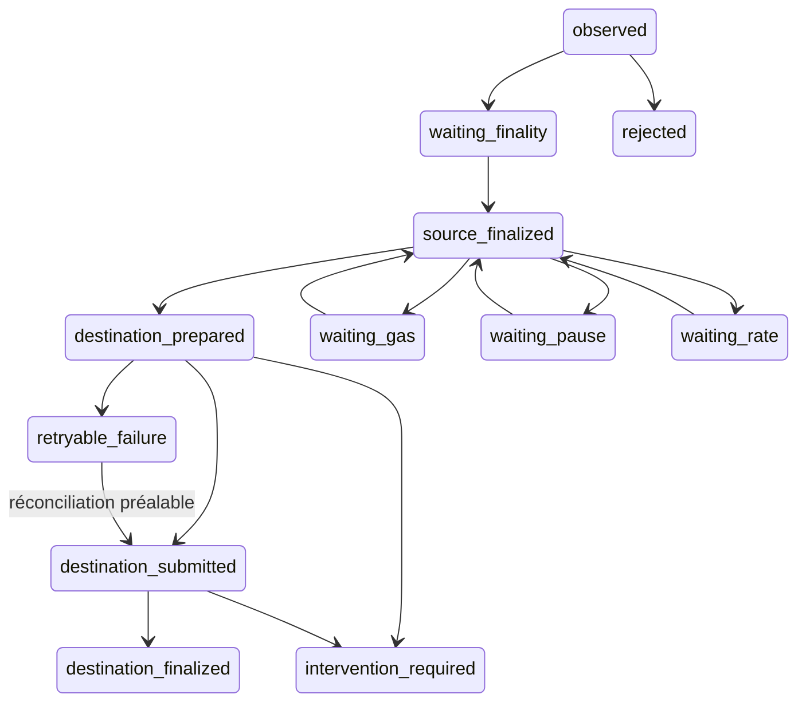

# ADR-0003 — reprise et finalité

Date initiale et mise à jour : 2026-10-24. Statut : mécanismes locaux implémentés ;
expériences et version vérifiée dans [les résultats](../resultats.md).

## Décision initiale

Préférer la lecture historique `eth_getLogs` avec checkpoint durable à une
collecte dépendant uniquement de WebSocket. Conserver chaîne, bridge, numéro
et hash de bloc, transaction et index de log ; dédupliquer aussi par ID métier.
Le checkpoint et les événements d'un lot doivent être commis ensemble.

Réserver durablement les nonces et persister la transaction signée avant envoi.
Un résultat RPC ambigu impose une réconciliation ; l'absence de reçu n'autorise
jamais un mint compensatoire. La conception envisageait une réservation
`FOR UPDATE SKIP LOCKED` ou un bail ; l'implémentation retient les verrous
consultatifs décrits ci-dessous.

Définir une politique de finalité par réseau, sans repli silencieux, et rendre
les observations orphelines inéligibles. Une intervention humaine, éventuellement
accompagnée d'une pause autorisée, est préférable à une correction autonome
de l'offre.

## Mise en œuvre observée : collecte et concurrence

`Collector.cs` lit des lots d'au plus 32 blocs. Le checkpoint est le prochain bloc
à lire ; hashes et parents des blocs sont persistés avec les événements dans
une transaction SQL. La variation du nonce source et sa séquence doivent
correspondre aux logs : une réponse historique vide ou tronquée ne doit pas
faire avancer le checkpoint.

`PostgresStore.cs` utilise des **verrous consultatifs PostgreSQL de session**
sur des connexions dédiées : initialisation, collecte par chaîne, traitement
par chaîne destination et réconciliation. Le verrou de traitement est partagé
entre workers et processus qui utilisent la même base. La paire courante
possède un compte signataire par destination ; ce verrou n'est pas un algorithme
générique multi-comptes.

La réservation du compteur `bridge.nonces` utilise `SELECT ... FOR UPDATE`,
puis incrémente le compteur et affecte le nonce au transfert dans une transaction.
Les contraintes d'unicité portent sur ID de transfert, observation
`(source_chain, source_bridge, block_hash, transaction_hash, log_index)` et
`(destination_chain, destination_signer, destination_nonce)`.
Il n'y a pas de `SKIP LOCKED` ni de bail expirant dans ce chemin.

Le diagramme résume les chemins principaux ; les états sont réévalués selon
la cause. `schema.sql` et `TransferProcessor.cs` définissent les transitions
effectives, notamment les échecs à plusieurs étapes.

## Mise en œuvre observée : soumission et reprise

`destination_prepared` signifie que la préparation durable précède la diffusion :
nonce, prix, payload signé et hash sont conservés en base. Le relayer revérifie
le hash source juste avant envoi. Une reprise vérifie, dans cet ordre utile,
reçu et bloc canonique, succès et `processed`, nonces latest/pending, puis présence
de la transaction. Un mint sans reçu propre, un nonce consommé inconnu ou un
reçu reverted exige une intervention.

Une rediffusion éventuelle réutilise les mêmes octets signés, le même nonce et
le même ID métier. **Aucun remplacement automatique de frais n'est implémenté.**
Un remplacement éventuel conserverait nonce et transfert ; un nouveau burn
est une autre opération métier et ne doit pas être créé pour résoudre un timeout.

Les valeurs par défaut appliquées sont 12 tentatives, un timeout RPC de
5 secondes, 10 tentatives par minute et destination suivies en base et une
attente pending maximale de 300 secondes. Les erreurs RPC peuvent consommer
des tentatives ; les états gas/pause/fréquence évitent une diffusion immédiate.
Le réessai utilise un délai exponentiel plafonné à 30 secondes. Même si le
dernier envoi autorisé a une réponse ambiguë, une passe de réconciliation
reste possible avant d'appliquer la limite. Le signataire possède en plus
son propre limiteur de signatures ; voir [sécurité](../securite.md).

Chaque cycle valide les **deux** identités, contrats et rôles avant collecte et
traitement. Si cette étape échoue, le cycle est dégradé avant même qu'un nouveau
burn soit collecté. L'état HTTP indique cette panne ; il n'est pas nécessaire
qu'une ligne de transfert non encore observé soit en `retryable_failure`.

## Finalité et réorganisations

| Réseau | Politique effectivement disponible |
|---|---|
| Anvil local | `head - blockNumber >= 3` par défaut : **trois blocs après inclusion**, et non trois blocs en comptant celui d'inclusion |
| Besu local | `qbft-local` utilise le bloc accepté en tête du mono-validateur ; hypothèse de cette simulation sans tolérance byzantine |
| Sepolia | Intégration non implémentée ; l'usage du tag `finalized` proposé initialement reste à vérifier et réaliser |
| Véritable TELA de test | Politique inconnue et intégration désactivée jusqu'à connaissance du réseau et du RPC |

Inclusion, convention de confirmations et finalisation sont distinctes.
Un mode non supporté ou un état historique indisponible provoque une erreur ;
aucun fallback silencieux vers `latest` ou vers un seuil plus faible n'est fourni.

Le collecteur recherche un ancêtre dans une fenêtre de 128 blocs. Il conserve
les observations orphelines avec `canonical=false` et repositionne le checkpoint.
Sans nonce destination réservé, le transfert est rejeté ; avec une opération
engagée, il passe en intervention requise. Une réorg au-delà de la fenêtre
échoue explicitement.

La réconciliation détecte aussi la perte d'un effet précédemment déclaré
finalisé et la signale comme intervention, sans le reclasser silencieusement
en transit normal. **Elle n'appelle pas automatiquement `pause()`.** L'opérateur
doit évaluer et faire appliquer la pause par le rôle habilité. Aucune correction
autonome d'offre n'est effectuée.

## Vérification, conséquences et limites

Les tests isolés couvrent RPC indisponible/lent/incohérent, réponse d'envoi
perdue, reprise, nonce, reorg et réconciliation. Les tests avec services exercent
arrêt/reprise, recollecte, pause, gas, concurrence, sorties de processus après
signature persistée et après diffusion, puis réorg Anvil préfinalité.
RELAYER-001, RESILIENCE-001 et RECON-001 distinguent ces méthodes et leurs résultats.

Le crash après diffusion se produit après retour RPC positif et avant écriture
submitted ; ce n'est pas une réponse réseau supprimée. PostgreSQL, le signataire
et l'hôte restent des dépendances de disponibilité ; les verrous de session
ne remplacent ni sauvegarde ni haute disponibilité. Le traitement est réessayable
avec effet métier idempotent, sans atomicité distribuée.

La persistance Anvil et ses bornes mesurées sont décrites dans
[ADR-0005](0005-persistance-anvil.md). Les tests de reprise de nœuds couvrent un
arrêt propre ; les crashs du relayer n'établissent pas une résistance des chaînes
à une coupure de l'hôte. Aucun scénario Anvil ne démontre la finalité TELA.

Références : [verrous PostgreSQL](https://www.postgresql.org/docs/17/explicit-locking.html),
[interfaces applicatives](0004-interfaces-application.md),
[protocole et confiance](0002-protocole.md), [sources](../sources.md).
