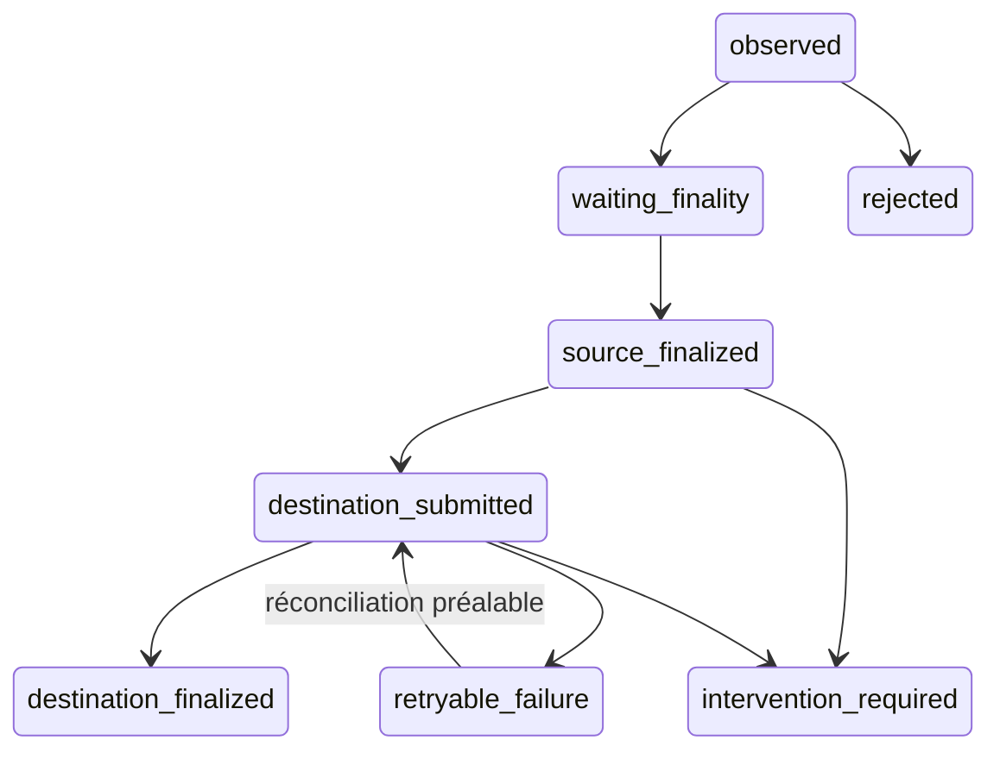

# ADR-0003 — reprise et finalité

Date : 2026-10-24. Statut : conception pour les jalons 2–3.

**Collecte.** Lecture historique `eth_getLogs` paginée, checkpoint persistant avec
numéro et hash de bloc ; WebSocket seulement accélérateur. Clé d'unicité du log :
chain ID, adresse du bridge, transaction hash, log index, avec block hash pour
détecter un remplacement canonique. Identifiant de transfert également unique.
Le checkpoint et les événements d'un lot doivent être commis ensemble.

**Soumission.** Réservation transactionnelle du travail (`FOR UPDATE SKIP LOCKED`
ou bail borné), contrainte d'unicité sur `(chain_id, signer, nonce)`. Persister le
nonce, le payload et le hash signé avant envoi. Une réponse perdue se réconcilie
par reçu, hash de transaction, nonce et `processed(id)` avant toute réémission.
Un remplacement conserve nonce et transfert ; un nouveau transfert est une autre
opération métier. Une absence de reçu n'autorise jamais un mint compensatoire.

**Finalité.** local-fast : convention explicite de trois confirmations, utile aux
tests, pas finalité économique. local-besu : bloc accepté en QBFT mono-validateur,
sans tolérance byzantine. Sepolia : tag `finalized`, hash relu avant traitement,
échec explicite si indisponible. TELA : politique indéfinie et désactivée tant que
consensus et RPC ne sont pas vérifiés. Inclusion, confirmations et finalisation
sont des notions distinctes ; aucun repli silencieux.

**Reorg.** Revalider les ancêtres avant finalité, retirer de l'éligibilité les
observations devenues orphelines et rescanner depuis le dernier point cohérent.
Si une violation survient après la politique de finalité retenue et qu'un crédit
est possible, déclencher une intervention et une pause ; pas de correction de
l'offre autonome. Un scénario Anvil ne démontre pas la finalité du véritable TELA.

**Limite mesurée au jalon 1.** La persistance testable concerne seulement les
volumes de nœuds et un témoin SQL. Aucun de ces mécanismes applicatifs n'existe encore.
