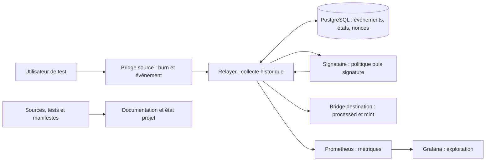
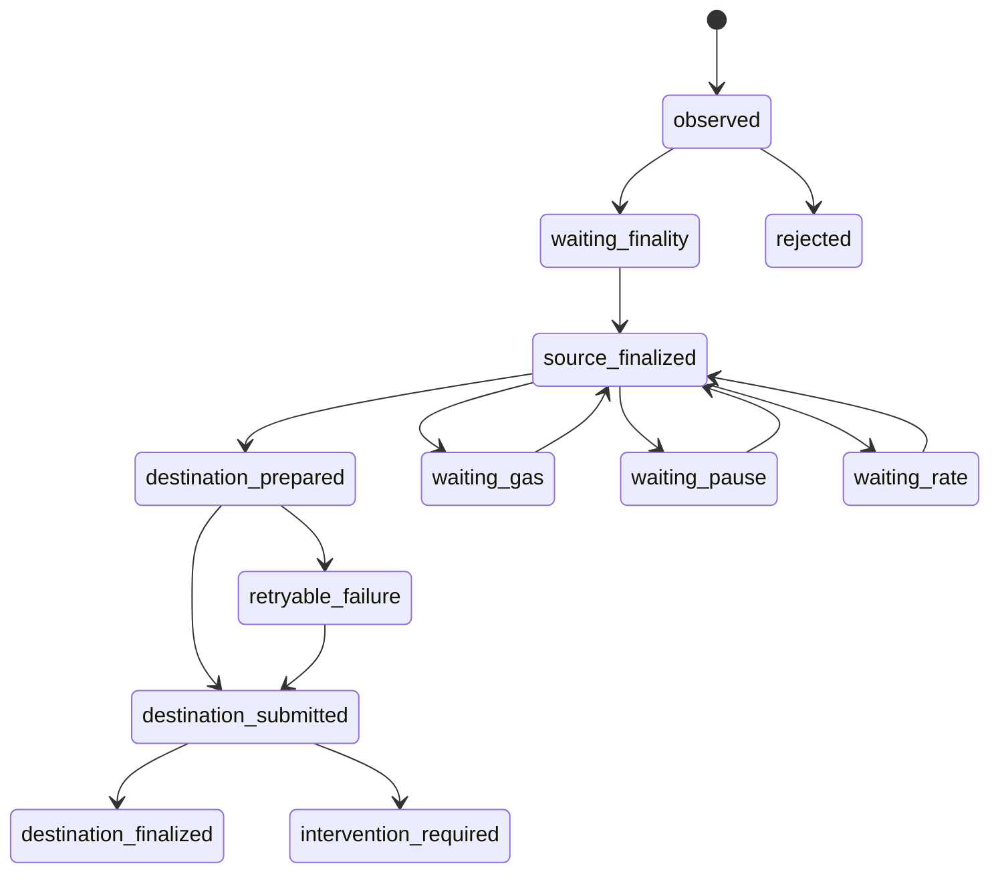

# Architecture et flux de confiance

## Périmètre et décisions

Le code comporte deux contrats Solidity, un relayer .NET, un signataire .NET
séparé, PostgreSQL et les services de supervision. Leur présence est une
observation de code. Les campagnes qui valident leur exécution sont identifiées
dans [les résultats](resultats.md) et le [registre](claims.yaml), notamment
CONTRACT-001, SIGN-001, RELAYER-001, TRANSFER-001 et BESU-PROTO-001.

| Profil | Composition | Portée autorisée |
|---|---|---|
| local-fast | Deux Anvil, chain IDs 31337 et 31338 | Protocole, reprise et injections locales |
| local-besu | Besu 31339 en QBFT local mono-validateur et Anvil 31340 | Compatibilité avec le client, le genesis et les contrats effectivement testés |
| integration-testnet | Sepolia et véritable TELA de test | Désactivé : paramètres et autorisations manquants |

Le Besu local ne représente pas l'identité du véritable TELA. Son consensus
QBFT n'établit aucun fait sur le consensus TELA. La version exacte des images
est définie par `sandbox/versions.lock.json` et enregistrée par chaque campagne.
Anvil et Forge ont des images distinctes ; le compilateur Solidity cible London.
La conservation des états historiques Anvil est nécessaire aux lectures par
hauteur de la collecte et de la réconciliation.

La VM dédiée reste une exigence : l'hôte Windows et le moteur Docker initiaux
sont partagés. Les conteneurs ne confinent pas l'administrateur de cet hôte
([limites](limites.md), ENV-01).

## Compartiments implémentés



| Service | Réseaux privés nécessaires | Données persistantes ou secrets nécessaires |
|---|---|---|
| Chaînes A et B | Chacune son réseau `chain_a` ou `chain_b` | Volume de chaîne propre |
| Relayer | `chain_a`, `chain_b`, `database`, `signing`, `monitoring` | PostgreSQL ; mot de passe applicatif et jeton de signature |
| Signataire | `signing` | Deux clés dédiées et jeton de service, montés en lecture seule |
| PostgreSQL | `database` | Volume base ; secrets administrateur et applicatif |
| Prometheus / Grafana | `monitoring` | Volumes distincts ; seul Grafana reçoit son mot de passe |
| Documentation | `documentation` | Site généré monté en lecture seule |

Les passerelles HTTP joignent un seul service cible et un réseau edge propre,
sans masquerading, pour publier les consultations sur `127.0.0.1`. Elles ne
proposent ni CONNECT ni destination arbitraire. Un réseau partagé autorise les
communications entre ses membres ; il ne constitue pas une ACL par méthode RPC.
Les résultats de cloisonnement sont distincts de la validation du YAML :
CFG-001, ISO-001, ISO-002, KEY-001.

## Contrats, rôles et identifiant

`contracts/src/BridgeToken.sol` implémente un token de test à 18 decimals avec
OpenZeppelin 5.4.0. Le bridge exige le bytecode de cette implémentation dédiée :
pas de proxy, rebase, frais de transfert ni conversion de decimals. Le code d'un
token sur une autre chaîne ne peut pas être vérifié depuis le contrat local ;
le relayer vérifie les adresses, les empreintes du code et les decimals configurés.

`BridgeToken.BRIDGE_ROLE` permet `mint` et `burnFrom`. Le burn dépense l'allowance
que l'utilisateur a accordée au bridge ; la dépense, le burn et l'événement
source appartiennent à la même transaction. L'administrateur du token peut
attribuer des rôles de mint supplémentaires, ce qui sort de l'hypothèse
d'absence d'émissions externes.

| Rôle du bridge | Pouvoir |
|---|---|
| `DEFAULT_ADMIN_ROLE` | Configurer une paire une seule fois, attribuer/retirer les rôles, lever la pause |
| `PAUSER_ROLE` | Mettre en pause burns et mints |
| `EXECUTOR_ROLE` | Présenter un transfert pour mint sur la paire autorisée |

Les trois comptes sont distincts dans le déploiement local. L'administrateur
reste capable de réattribuer ces rôles. Une paire configurée ne peut pas être
remplacée : cela évite qu'un changement de destination rende un burn en transit
impossible à terminer. Une migration exige un nouveau déploiement et une
procédure explicite de traitement du transit.

`requestTransfer(destinationChainId, recipient, amount)` brûle et émet
`TransferInitiated`. Le nonce source commence à zéro et augmente à chaque burn
réussi. `completeTransfer(sourceChainId, sourceBridge, sourceToken, nonce,
amount, recipient)` vérifie le rôle, la paire, les plafonds et `processed`.
L'enregistrement de l'identifiant et le mint sont atomiques ; un revert les
annule ensemble. Les deux chemins métier sont protégés contre la réentrance.

L'identifiant v1 est exactement :

```text
keccak256(abi.encode(
  keccak256("T3L4N_BRIDGE_BURN_MINT"), uint256(1),
  sourceChainId, sourceBridge, destinationChainId, destinationBridge,
  sourceToken, destinationToken, nonce, amount, recipient
))
```

Les montants sont des entiers en unités minimales. L'événement source expose ID,
chaîne destination, émetteur, destinataire, paire, bridge destination, nonce et
montant ; l'événement destination expose ID, destinataire et montant.
Le vecteur indépendant est dans `contracts/vectors/transfer-id-v1.json`.
La protection contre les doublons ne prouve pas le burn distant : un exécuteur
autorisé compromis peut fabriquer un mint sous les plafonds du contrat
(CONTRACT-001 ; [modèle de menace](securite.md)).

## Collecte, finalité et reprise

`Collector.cs` interroge l'historique HTTP par lots d'au plus 32 blocs. Le
checkpoint persistant est le **prochain bloc à lire**. Les hashes et parents de
blocs, hashes de transactions et index de logs sont conservés. La variation de
`nextNonce()` source doit correspondre au nombre et à la séquence des événements :
une réponse de logs tronquée ne doit pas faire avancer silencieusement le checkpoint.

Chaque cycle vérifie d'abord les deux identités réseau, les contrats et les
rôles. Un RPC indisponible à cette étape arrête le cycle avant collecte et
soumission ; l'API indique un état dégradé. Il n'existe pas de dépendance à un
flux WebSocket pour rattraper les événements.

Sur Anvil, la convention implémentée exige `head - blockNumber >= confirmations`,
avec trois blocs successeurs par défaut. Il s'agit d'une convention de simulation,
pas d'une finalité économique. Le mode `qbft-local` utilise la tête du Besu local
selon l'hypothèse de ce réseau privé mono-validateur. Aucun de ces modes ne
définit la finalité de Sepolia ou TELA. Un mode inconnu est refusé.



Ce diagramme montre les principaux chemins ; les états d'attente sont réévalués
selon la cause et un échec peut survenir à plusieurs étapes. Le schéma SQL est
la référence exhaustive.

Les verrous consultatifs PostgreSQL sérialisent la collecte par chaîne et le
traitement par chaîne destination. La paire actuelle utilise un compte de
signature par destination. La réservation de nonce et l'incrément du compteur
sont transactionnels ; une contrainte unique porte sur chaîne, compte et nonce.
Les observations et transferts possèdent également leurs clés d'unicité.

Le payload signé et son hash sont conservés **avant** diffusion. Après timeout
ou redémarrage, le relayer recherche le reçu, vérifie son bloc canonique et
`processed`, puis compare les nonces latest/pending et la présence de la transaction.
Une rediffusion éventuelle réutilise les mêmes octets. Aucun remplacement
automatique de frais, nouveau transfert ou mint compensatoire n'est produit.

Une réorganisation source conserve les observations orphelines avec
`canonical=false`. Sans nonce réservé, le transfert est rejeté ; une opération
déjà engagée demande une intervention. La recherche d'ancêtre est bornée à
128 blocs ; au-delà, le collecteur échoue explicitement. Il n'y a aucune
transaction atomique distribuée entre les deux chaînes et PostgreSQL
(RELAYER-001, RESILIENCE-001).

## Réconciliation de l'offre

`Reconciler.cs` choisit un bloc selon la politique de finalité de chaque réseau,
attend la couverture des collecteurs, lit les offres à ces hauteurs et associe
les burns canoniques aux completions et à `processed` au bloc choisi.

```text
offre_A(coupe_A) + offre_B(coupe_B) + transit_non_minté(coupes)
    = offre_de_référence
```

Le transit inclut les deux sens, une fois par identifiant. Un mint inclus dans la
coupe destination dont le burn n'est pas inclus dans la coupe source rend le
résultat `inconclusive`. Les hashes des coupes sont relus avant conclusion.
Un événement de completion incohérent, une collecte en retard ou une couverture
de logs insuffisante ne donnent pas un résultat équilibré.

`balanced` signifie que l'égalité est satisfaite sous ces hypothèses ;
`mismatch` impose une enquête ; `unavailable` ou `inconclusive` ne valent pas
validation. Une émission externe peut produire un écart, mais des émissions et
des destructions externes qui se compensent peuvent échapper à cette seule
égalité. Il ne s'agit donc pas d'un registre exhaustif des pouvoirs de mint.
La perte d'un effet précédemment déclaré finalisé est signalée en intervention,
sans compensation automatique. Le contrôle relit l'historique et parcourt les
transferts : son coût croît avec la durée et l'activité ; aucun débit n'est
mesuré (RECON-001).

Décisions : [stack et profils](adr/0001-stack-profils.md),
[protocole](adr/0002-protocole.md), [reprise](adr/0003-reprise-finalite.md),
[interfaces](adr/0004-interfaces-application.md),
[persistance Anvil](adr/0005-persistance-anvil.md).
