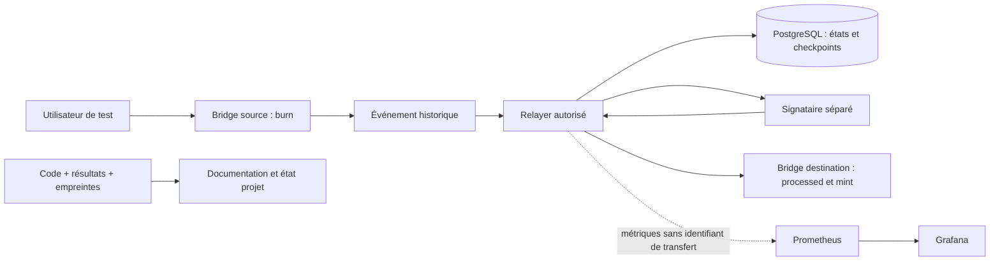

# Architecture et flux de confiance

La cible comporte une VM dédiée. Dans cette VM, chaque catégorie de service
dispose de ses réseaux et volumes. Sur l'hôte initial, cette séparation n'existe
qu'au niveau des conteneurs du projet ; la VM et le moteur sont partagés.

Ce diagramme est la **cible**. Au jalon 1, seuls les nœuds, PostgreSQL, le serveur
de documentation et les témoins d'isolation sont exécutables. Relayer, signataire,
contrats et supervision métier ne sont pas simulés par des services affichant
une santé artificiellement positive.

| Compartiment | Réseau(s) cible | Écriture autorisée | État J1 |
|---|---|---|---|
| Chaîne A | chain_a | volume du nœud | Implémenté |
| Chaîne B | chain_b | volume du nœud | Implémenté |
| Relayer | chain_a, chain_b, database, signing, monitoring | états dans PostgreSQL | Conception |
| PostgreSQL | database | volume base, socket tmpfs | Implémenté, sans schéma métier |
| Signataire | signing | clés de test en lecture seule | Témoin inoffensif pour tests seulement |
| Supervision | monitoring | volumes séries et tableaux | Conception |
| Documentation | documentation | site monté en lecture seule | Implémenté |

La confiance du mint est décrite dans [ADR-0002](adr/0002-protocole.md) ; les
checkpoints et la finalité dans [ADR-0003](adr/0003-reprise-finalite.md).
Les frontières réseau testées ne filtrent pas finement les ports entre deux
services membres du même réseau. Les réseaux futurs du relayer restent à
recetter une fois celui-ci implémenté.

Trois passerelles HTTP à cible fixe (`rpc-a`, `rpc-b`, `docs-gateway`) exposent
les consultations sur loopback. Chacune joint uniquement son réseau privé et
un réseau edge distinct dont le masquerading est désactivé. Elles n'acceptent
ni CONNECT ni destination arbitraire. Cette adaptation est nécessaire sur le
Docker Desktop testé : un service uniquement sur réseau internal était sain,
mais son port publié n'était pas accessible depuis Windows.
