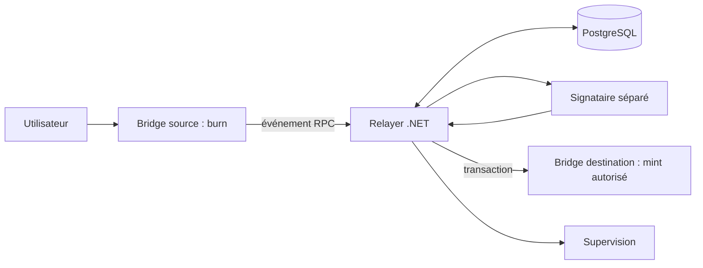

# Évaluation indépendante — état partiel

Date : 3 novembre 2026. Commit examiné : `2fc15a44bc965e7870e56dfa604b3a99bc3be5a2`. Arbre Git propre au début de l'examen. Cette évaluation est préliminaire : elle ne constitue pas l'audit exhaustif demandé. Les chemins critiques .NET, la CI, les dépendances et les campagnes n'ont pas été examinés intégralement ; les notes seraient donc trompeuses et ne sont pas attribuées.

## Synthèse et périmètre

Le projet vise un démonstrateur de transfert bidirectionnel de tokens ERC20 dédiés entre environnements EVM de test. Les destinataires plausibles sont les équipes d'intégration et d'expérimentation ; aucune validation de demande client n'a été examinée. La valeur envisageable est une sandbox reproductible adaptée à un contexte TELA encore à identifier. L'intégration réelle est désactivée selon `README.md` ; l'accès et les paramètres TELA restent à établir.

Le contrat `contracts/src/Bridge.sol` brûle le token source et autorise un exécuteur à frapper sur la destination. Il ne vérifie aucune preuve interchaîne : un exécuteur autorisé peut fabriquer une observation, sous réserve des plafonds. Le hash d'identifiant, la protection contre le rejeu et les plafonds ne corrigent pas cette hypothèse de confiance. Les composants de persistance, collecte, signature et supervision sont présents mais leurs chemins n'ont pas été vérifiés intégralement lors de cet examen.

Le schéma représente les composants identifiés dans `contracts/src/Bridge.sol`, `src/Bridge.Relayer/`, `src/Bridge.Signer/` et `sandbox/compose.bridge.yaml` ; leurs interactions exactes restent à vérifier de bout en bout.

## Inventaire et résultats

Les statuts concernent l'examen courant, non les intentions :

| Fonction | Statut | Preuve et limite |
|---|---|---|
| Tests Python d'outillage | VERIFIED | `python -m unittest discover -s tests -p 'test_*.py'` : 108 tests, succès, 0,260 s ; ce temps n'est pas un benchmark système. |
| Burn/mint, séparation de domaine, anti-rejeu, pause et plafonds | IMPLEMENTED | `contracts/src/Bridge.sol` ; tests Solidity non exécutés pendant cet examen. |
| Transferts et reprise interchaînes | UNKNOWN | `docs/resultats.md` décrit des campagnes Anvil et Besu sur `b97c541`, antérieures à HEAD ; leurs résultats ne valident pas automatiquement HEAD. |
| Intégration Sepolia et TELA | DOCUMENTED ONLY | `README.md` indique explicitement que l'intégration réelle est désactivée ; aucune expérience réelle vérifiée ici. |
| Signataire, relayer, réconciliation et supervision | UNKNOWN | Sources et tests présents ; exécution et comportement précis non vérifiés ici. |
| Agents et skills | PARTIAL | Catalogue présent dans `docs/agents.md` et `.agents/skills/` ; aucun résultat autonome ni performance de modèle n'a été évalué. |

`docs/resultats.md` rapporte historiquement 18 contrôles par profil, ainsi que des tests et injections ; il indique lui-même que les modifications ultérieures rendent ces preuves obsolètes. Aucun débit, latence, coût par transfert ni endurance n'a été mesuré ici. Docker serveur 28.3.2 répond ; aucune campagne `prove` n'a été lancée, car elle arrête et redémarre les services du projet et peut affecter une instance existante.

## Science, sécurité et comparaison

Le problème est un problème distribué de cohérence sous hypothèses de finalité et de confiance, non une découverte scientifique démontrée. `Bridge.sol` utilise `keccak256` et `abi.encode` pour l'identification contextualisée ; la résistance du hash ne démontre ni l'existence ni la finalité du burn. Les montants sont entiers et le contrat impose 18 décimales ; les conversions hors contrat n'ont pas été auditées. La complexité et les limites mémoire des collecteurs, ainsi que les garanties de reprise, restent à mesurer. Aucun modèle prédictif n'a été identifié dans le périmètre inspecté ; cela ne prouve pas son absence dans tout le dépôt.

Le risque principal démontré par conception est la compromission ou l'abus de l'exécuteur : il peut produire des mints sans burn authentifié jusqu'aux plafonds. La sécurité du signataire, l'authentification entre services, la gestion des secrets et les conditions de concurrence nécessitent une revue distincte. Le Besu local mentionné dans `docs/resultats.md` est mono-validateur et ne démontre pas une tolérance byzantine.

À titre de comparaison documentaire, [Chainlink CCIP](https://docs.chain.link/ccip/concepts/service-responsibility) décrit plusieurs modèles de transfert et attribue des responsabilités aux vérificateurs et développeurs de tokens ; ceci ne constitue pas une mesure indépendante de ses performances ni une preuve de compatibilité TELA. Le [SoK sur la sécurité des bridges](https://arxiv.org/abs/2312.12573) décrit des surfaces d'attaque et défenses ; il ne valide pas ce projet. Les prix, performances comparables et coûts opérationnels n'ont pas été établis. Une sandbox maîtrisable pourrait être préférée pour l'apprentissage ou une intégration spécifique ; un client exigeant refuserait aujourd'hui l'absence de preuve de burn, de campagne actuelle et de validation de l'environnement cible.

## Risques et suites prioritaires

| Risque | Gravité | Probabilité | Force de preuve |
|---|---|---|---|
| Mint frauduleux par exécuteur autorisé | Critique | Non quantifiée | Forte : contrat |
| Hypothèses TELA incorrectes | Élevée | Non quantifiée | Moyenne : prérequis documentés non confirmés |
| Régression depuis les campagnes historiques | Élevée | Non quantifiée | Forte pour l'écart de commit ; aucune régression démontrée |
| Panne ou incohérence RPC et finalité | Élevée | Non quantifiée | Moyenne : architecture distribuée ; scénarios actuels non rejoués |
| Clé ou signataire compromis | Critique | Non quantifiée | Hypothèse de menace ; protections non auditées |

Actions proposées, estimations provisoires en jours-ingénieur pour une personne connaissant .NET, Solidity et Docker, hors accès externe :

| Horizon | Priorité et composant | Difficulté / charge | Bénéfice et critère | Dépendances |
|---|---|---|---|---|
| 7 jours | P0, preuves et environnement | Moyenne, 2–4 j | Rejouer les campagnes locales sur sources figées ; manifests, sorties et écarts conservés | Instance isolée et images reconstruites |
| 7 jours | P0, contrat et signataire | Élevée, 2–4 j | Documenter les hypothèses et simuler un exécuteur malveillant ; test reproductible | Environnement local |
| 30 jours | P1, relayer et stockage | Élevée, 8–15 j | Revoir collecte, concurrence, reprise et reorg ; tests ciblés reproductibles | Campagne actuelle |
| 30 jours | P1, mesures | Moyenne, 4–7 j | Mesurer latence, débit et ressources avec protocole, répétitions et données brutes | Environnement isolé |
| 90 jours | P1, intégration cible | Élevée, 15–30 j | Démonstration sur réseaux de test autorisés avec identités et critères validés | Accès, permissions et paramètres réels |
| 90 jours | P1, sécurité et utilisateurs | Élevée, 15–30 j | Revue indépendante, exercices de récupération et entretiens utilisateurs documentés | Modèle de confiance et accès utilisateurs |

Ces charges ne sont ni un devis ni un calendrier garanti. Un produit fiable nécessiterait notamment exploitation, gestion des clés, sécurité indépendante et validation de la demande ; coût total et effectifs restent inconnus.

## Verdict et limites

**NOTE TECHNIQUE : non évaluée /100**

**MATURITÉ PRODUCTION : non évaluée /100**

**POTENTIEL STRATÉGIQUE : non évalué /100**

**NIVEAU D'INGÉNIERIE DÉMONTRÉ : indéterminé à ce stade**

**CONFIANCE DANS L'ÉVALUATION : Faible**

**Pourquoi ce projet mérite d'exister.** Une sandbox de bridge permet d'étudier la reprise et les frontières de confiance sans actifs réels.

**Pourquoi ce projet pourrait échouer.** La confiance dans l'exécuteur, l'incertitude sur TELA et l'absence de demande commerciale démontrée peuvent empêcher son adoption.

**Ce qu'il faut démontrer pour qu'un expert indépendant le prenne réellement au sérieux.** Rejouer les campagnes sur le commit courant, auditer les chemins de confiance et la reprise, puis publier des mesures reproductibles et une validation de l'environnement cible.

## Annexe : observations de session

- `git status --short --branch` : branche `codex/bridge-sandbox-evidence`, arbre propre avant rédaction.
- `git rev-parse HEAD` : `2fc15a44bc965e7870e56dfa604b3a99bc3be5a2`.
- `git log -5 --oneline` : plusieurs correctifs postérieurs aux campagnes historiques.
- `python -m unittest discover -s tests -p 'test_*.py'` : code 0, 108 tests réussis.
- `docker version --format '{{.Server.Version}}'` : 28.3.2, code 0.
- Issues, pull requests, discussions, historique complet, provenance des contributions et autres dépôts : non examinés. Les évaluations détaillées sur 100, les dix risques et la red team complète restent à réaliser.
