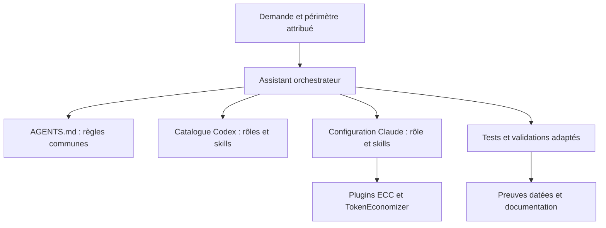

# Guide technique de la factory agentique

État documentaire au 3 novembre 2026. La factory est un ensemble de définitions, procédures et extensions d'assistants de développement, spécialisé dans ce dépôt. Elle ne constitue pas un service autonome permanent ; la disponibilité des agents, outils et permissions dépend de la session qui les charge.

## Composition



| Élément | Emplacement | Fonction et limites |
|---|---|---|
| Instructions communes | `AGENTS.md` | Périmètre, sécurité, preuve et exigences du projet. |
| Rôles Codex | `.codex/agents/` | 50 définitions de missions spécialisées ; pas 50 processus actifs. |
| Skills Codex | `.agents/skills/` | 50 procédures par sujet ; sélection selon la tâche et la disponibilité de session. |
| Catalogue | [agents.md](agents.md) | Liste des rôles, règles de délégation et amélioration. |
| Validateur | `scripts/validate_capabilities.py` | Vérifie les structures et associations ; ne mesure pas les compétences. |
| Instructions Claude | `CLAUDE.md` | Oriente Claude vers les règles communes et la séparation des preuves. |
| Rôle Claude local | `.claude/agents/bridge-reviewer.md` | Revue du bridge avec outils de lecture déclarés ; cette restriction ne constitue pas une isolation OS. |
| Skill Claude local | `.claude/skills/bridge-review/SKILL.md` | Procédure de revue des risques et preuves. |
| Skill Cloudflare | `.claude/skills/security-audit/` | Audit de sécurité tiers, licence et référence du commit conservées localement. |
| Plugins Claude | `.claude/settings.json` | Références de marketplace et activation d'ECC et TokenEconomizer pour le projet. |

Les deux catalogues ne sont pas interchangeables automatiquement : il faut vérifier le chargement effectif dans chaque hôte. La configuration actuelle requiert au moins 50 paires Codex ; une réduction nécessite une décision sur les exigences et une adaptation du validateur, pas une suppression isolée.

## Méthode d'orchestration

1. Partir d'une demande délimitée : résultats attendus, environnement, fichiers attribués et limites. Lire les règles applicables et l'état Git.
2. Choisir uniquement les rôles et skills nécessaires. Attribuer les fichiers sans chevauchement et respecter la concurrence permise par la session. Les éventuels sous-agents héritent des permissions de l'environnement ; une instruction « lecture seule » n'est pas une frontière technique.
3. Faire relire les changements critiques par un intervenant distinct lorsque cette capacité existe. Les décisions restent liées aux exigences et aux ADR du projet.
4. Exécuter les tests adaptés et distinguer résultat réel, simulation, double de test, absence de preuve et campagne historique. Enregistrer les limites, commandes et preuves non sensibles.
5. Après un défaut observé, utiliser `bridge-amelioration` : reproduire, corriger au périmètre minimal, rejouer le cas et un cas voisin, valider et consigner. Cela ne garantit pas une amélioration autonome permanente.

Exemple de mission : « Examiner le changement de finalité dans les fichiers attribués, identifier les hypothèses de confiance et produire les tests discriminants, sans modifier les autres fichiers. » La définition d'un rôle ou la réussite de sa validation syntaxique ne prouvent pas que cette mission a été exécutée.

## Extensions et fonctionnement réel

| Extension | Ce qui est installé | Limites constatées |
|---|---|---|
| TokenEconomizer | Plugin Claude activé dans la configuration projet ; version observée 0.1.0. | Ses hooks et économies ne sont pas mesurés ici. Claude 2.1.312 dépasse la plage testée indiquée lors de l'installation. Il ne garantit pas un plafond de dépense. |
| ECC | Plugin Claude activé pour le projet ; version observée 2.2.3. | Agents, skills et hooks tiers ; hooks annoncés activés par défaut, interactions et fonctionnement effectif non testés. Les règles et MCP additionnels ne sont pas automatiquement établis par leur simple mention. |
| Cloudflare Security Audit | Copie locale du skill au commit `c1c8a8c1471069fb0e188eeaff69b8e8db6564a8`. | Sous Windows et Node 20.19.5, les tests de validateurs ont donné 46 succès, 7 échecs, 12 ignorés. Le workflow exige une sandbox OS adaptée pour exécuter du code cible. |

Les références distantes des marketplaces dans `.claude/settings.json` ne verrouillent pas leurs commits ; une actualisation peut changer leur contenu. Les versions observées et commandes d'installation sont détaillées dans `docs/audits/CLAUDE_FACTORY.md`. Une installation déclarée ne démontre pas la découverte, le comportement, la sécurité ou la compatibilité des hooks en session. Examiner les extensions et leurs permissions avant usage ; ne pas copier des hooks en double.

## Utilisation et validation

```powershell
python scripts/validate_capabilities.py
python -m unittest discover -s tests -p 'test_tooling.py'
claude plugin list
```

Le premier contrôle vérifie la structure des 50 paires Codex ; les tests Python couvrent l'outillage, pas l'efficacité des modèles. La liste Claude confirme un enregistrement local, pas l'exécution des hooks. Après redémarrage de Claude, vérifier la disponibilité des extensions dans sa propre interface et exécuter des cas représentatifs et négatifs, sans secrets. Le skill Cloudflare exige une isolation OS, notamment absence de réseau externe, environnement assaini et écritures limitées ; une restriction Compose déclarée ne prouve pas ces propriétés.

Pour les évaluations payantes autorisées, suivre les dépenses auprès du fournisseur et limiter séparément le budget de chaque exécution. Le budget de 150 $ indiqué par l'utilisateur est une autorisation maximale, pas un mécanisme technique de blocage. Ne jamais mettre de clé dans Git ou les logs ; `.env` est ignoré, mais peut tout de même être lu par les processus autorisés de l'hôte.

## État et travaux restants

La revue complète des 50 paires, l'évaluation comportementale de Claude, la compatibilité des hooks entre plugins et les mesures de coût restent à réaliser. Les audits de `docs/audits/` sont des documents de travail datés, notamment l'évaluation indépendante qui reste incomplète. La campagne du 3 novembre dans `evidence/20261103T092613Z-local-fast/` valide des contrôles du bridge et non la qualité des agents. Ne pas la présenter comme une validation de la factory.
