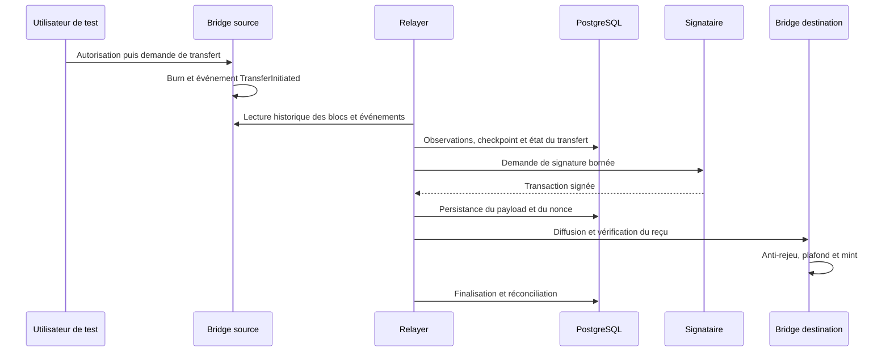

# Guide technique du dépôt

Ce guide décrit le démonstrateur et renvoie aux sources détaillées. État documentaire au 3 novembre 2026 ; une observation datée n'est pas une mesure en direct. Pour les règles, lire `AGENTS.md` à la racine. Pour les agents et extensions, consulter le [guide de la factory](factory-agentique.md).

## Objectif et périmètre

Le dépôt expérimente un transfert bidirectionnel de tokens ERC20 de test entre deux chaînes EVM. Un bridge source brûle les tokens ; un relayer autorisé transmet l'observation et déclenche un mint sur la chaîne destination. Le destinataire de cette sandbox est une équipe technique qui veut explorer déploiement, reprise, pannes et supervision. Il ne s'agit pas d'une solution de production ni d'une preuve cryptographique interchaîne : l'exécuteur autorisé peut fabriquer une observation et provoquer un mint dans les limites configurées.

| Profil | Réseaux | Portée |
|---|---|---|
| `local-fast` | Anvil 31337 et Anvil 31338 | Démonstration et injections locales, y compris réorganisation simulée. |
| `local-besu` | Besu 31339 et Anvil 31340 | Compatibilité Besu locale ; QBFT mono-validateur, sans conclusion sur TELA. |
| `integration-testnet` | Sepolia et TELA de test envisagés | Désactivé : identités, accès et autorisations réels à établir. |

Les détails de sécurité, de finalité et de confiance sont dans [l'architecture](architecture.md), [la sécurité](securite.md) et [les limites](limites.md). Les exigences sont dans [exigences.md](exigences.md) et les décisions dans `docs/adr/`.

## Architecture et flux



1. `contracts/src/BridgeToken.sol` définit le token dédié à 18 décimales. `contracts/src/Bridge.sol` gère paires, rôles, pause, plafonds, burn, mint et identifiant de transfert contextualisé. Une paire est configurée une seule fois ; l'administrateur conserve des pouvoirs sur les rôles.
2. `src/Bridge.Relayer/Collector.cs` collecte les logs historiques ; `PostgresStore.cs` et `schema.sql` conservent blocs, observations, états, nonces et tentatives. La finalité et la reprise sont distinctes de la simple réception d'un log.
3. `TransferProcessor.cs` coordonne la préparation et la soumission. Le signataire séparé `src/Bridge.Signer/` applique une politique à `POST /sign` et lit les clés ; le relayer conserve la transaction signée avant diffusion. Ce signataire local n'est pas un HSM.
4. `Reconciler.cs` compare les offres et les montants en transit sur des coupures vérifiées. `Prometheus` et `Grafana`, configurés dans `observability/`, rendent l'état observable ; les données anciennes ou indisponibles ne doivent pas être prises pour des données courantes.

La structure de la base est définie dans `src/Bridge.Relayer/schema.sql`. Les transitions et interfaces, y compris les limites de retry et les cas nécessitant une intervention, sont détaillées dans [ADR-0003](adr/0003-reprise-finalite.md) et [ADR-0004](adr/0004-interfaces-application.md). Les tests avec doubles RPC ne prouvent pas à eux seuls le fonctionnement entre chaînes.

## Carte des fichiers

| Chemin | Contenu et usage |
|---|---|
| `contracts/` | Contrats Solidity, OpenZeppelin intégré, tests Foundry, vecteurs et outils de vérification. |
| `src/Bridge.Relayer/` | Service .NET de collecte, traitement, stockage, réconciliation et métriques. |
| `src/Bridge.Signer/` | Service de signature et politique ; secrets lus depuis des fichiers fournis à l'exécution. |
| `src/Bridge.Operator/` | Outil ponctuel de déploiement et d'administration locale. |
| `sandbox/` | Compose, Dockerfiles, profils, configuration Besu et versions verrouillées. |
| `scripts/bridge.py` et `scripts/bridge_runtime.py` | Interface d'orchestration et opérations locales ; `scripts/bridge` et `scripts/bridge.ps1` sont des wrappers. |
| `tests/`, `contracts/test/`, `observability/tests/` | Tests Python, .NET, Solidity, résilience et supervision ; distinguer tests isolés et campagnes réelles. |
| `docs/`, `docs/claims.yaml`, `evidence/` | Documentation, registre d'affirmations et artefacts datés. |
| `.codex/`, `.agents/`, `.claude/` | Définitions agentiques et intégrations décrites dans le [guide dédié](factory-agentique.md). |

Les dépendances sont verrouillées notamment dans `sandbox/versions.lock.json`, `global.json`, les fichiers `packages.lock.json`, `contracts/solc.lock.json` et `requirements-docs.lock`. `sandbox/egress-policy.json` est une politique déclarative, pas à elle seule un pare-feu.

## Exécuter et observer

Prérequis, ressources et installation détaillée : [installation](installation.md). Les commandes suivantes concernent exclusivement le profil local ; `bootstrap` télécharge et prépare des dépendances et images. Vérifier les ressources de l'hôte et conserver les données existantes.

```powershell
python scripts/bridge.py doctor
python scripts/bridge.py bootstrap --profile local-fast
python scripts/bridge.py up --profile local-fast
python scripts/bridge.py demo --profile local-fast
python scripts/bridge.py status --profile local-fast
python scripts/bridge.py prove --profile local-fast
```

`demo` effectue des transferts de test. `prove` lance des tests et injections, puis arrête et redémarre les services du projet pour vérifier la persistance : ne pas l'assimiler à une simple lecture d'état. `python scripts/bridge.py down --profile local-fast` arrête le profil en conservant les volumes ; ne pas utiliser de nettoyage Docker global. Reconstruire les images concernées après une modification de leurs sources avant de refaire une campagne.

Pour `local-fast`, le statut courant du relayer est `http://127.0.0.1:18082/status`, la documentation servie `http://127.0.0.1:18080/` et Grafana `http://127.0.0.1:13000/d/t3l4n-bridge/`. `status` génère aussi une vue statique horodatée : la rafraîchir et vérifier sa date avant de la présenter. Voir [exploitation](exploitation.md) pour les diagnostics et alertes.

## Tests, preuves et limites

La campagne `local-fast` du 3 novembre 2026 a terminé avec `réussite=True` ; son <a href="../evidence/20261103T092613Z-local-fast/manifest.json">manifeste</a> consigne les contrôles, les empreintes et les fichiers. Elle inclut une démonstration aller-retour et des scénarios de résilience locaux. Son commit de base est `2fc15a44bc965e7870e56dfa604b3a99bc3be5a2` ; l'état Git enregistré contient aussi des fichiers non suivis, donc ce commit seul ne reproduit pas les sources exactes. L'empreinte courante a changé depuis cette campagne : sa réussite est une observation historique et ne valide pas l'état actuel. Vérifier l'empreinte et le [registre](claims.yaml) avant toute affirmation.

Les résultats anciens Besu et Anvil restent historiques ; l'exécution récente `local-fast` ne valide ni Besu actuel, ni Sepolia, ni TELA. Le catalogue de tests, les scénarios non équivalents et la procédure de conservation sont décrits dans [tests et preuves](tests-preuves.md) et [résultats](resultats.md). Le rapport d'audit indépendant dans `docs/audits/` est explicitement préliminaire.
